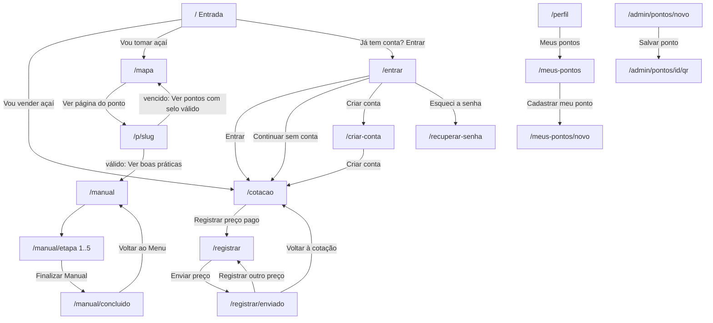

# Telas do protótipo e fluxo de navegação

Protótipo no Figma (cópia usada pela equipe):
https://www.figma.com/proto/DXFZzHY4puC1THLh0q5WJh/Prot%C3%B3tipo-DoRioaCuia--Copy-?node-id=66-17&starting-point-node-id=66%3A17

As imagens de cada tela estão no arquivo `telas_prototipo.pdf` (e em PNG na pasta `telas/`). São 37 telas de celular, desenhadas em 390 x 844 px (exportadas em 4x). O PWA deve reproduzir essas telas; quando o texto deste arquivo e a imagem divergirem, vale a imagem, e a divergência deve ser anotada.

O fluxo abaixo foi montado a partir das telas exportadas e dos links de protótipo do arquivo .fig. Onde o protótipo não tinha link, a navegação proposta está marcada como "proposta".

Além das 37 telas, o Figma tem o quadro FUNDO (1920 x 1080): fundo roxo em degradê com o ícone do app (quadrado creme de cantos arredondados com a cuia) e o nome "Do Rio à Cuia" em branco. Serve de splash/abertura e de capa para apresentação; está no pacote como `splash_fundo.png`.

## Mapa de rotas

| Rota | Tela (nome no Figma) | Login | Barra inferior |
| --- | --- | --- | --- |
| `/` | ENTRADA 1 | Não | Não |
| `/entrar` | ENTRAR | Não | Não |
| `/criar-conta` | criar conta | Não | Não |
| `/recuperar-senha` | sem tela (proposta) | Não | Não |
| `/cotacao` | cotação do dia | Não | Sim, Cotação ativa |
| `/registrar` | registrar preço | Sim | Sim, Cotação ativa |
| `/registrar/enviado` | preço enviado | Sim | Sim, Cotação ativa |
| `/mapa` | pontos de açaí | Não | Sim, Mapa ativo |
| `/p/[slug]` | selo válido / selo vencido (mesma rota, dois estados) | Não | Não |
| `/manual` | manual (progresso) e manual-1 (estado zerado) | Não | Sim, Manual ativo |
| `/manual/[etapa]` | recebimento 1-4, lavagem 1-4, branqueamento 1-5, armazenamento 1-4, venda 1-4 | Não | Não |
| `/manual/concluido` | checklist concluido | Não | Não |
| `/perfil` | perfil | Sim | Sim, Perfil ativo |
| `/meus-pontos` | pontos ("Meus pontos", estado vazio) | Sim (batedor) | Sim, Perfil ativo |
| `/meus-pontos/novo` | cadastrar ponto (reaproveitada, sem a marca Administrador) | Sim (batedor) | Não |
| `/admin/pontos/novo` | cadastrar ponto | Sim (admin) | Não |
| `/admin/pontos/[id]/qr` | qr code do ponto | Sim (admin ou dono do ponto) | Não |

As telas "recebimento 1, 2, 3, 4" etc. são a mesma etapa em estados diferentes (0, 1, 2... itens marcados). No código vira uma rota por etapa com estado.

## Fluxo

Barra inferior (4 itens, sempre na mesma ordem): Cotação `/cotacao`, Mapa `/mapa`, Manual `/manual`, Perfil `/perfil`. O item ativo vira uma pílula roxa com ícone e rótulo; os outros mostram só o ícone. Tocar em Perfil sem login leva a `/entrar`.

Ações que exigem login (Registrar preço pago, Perfil) levam a `/entrar?next=<rota>` e voltam para a rota depois do login.

Depois de criar conta: feirante e comprador vão para `/cotacao`; batedor vai para `/meus-pontos` (proposta).

## Tela a tela

### `/` Entrada (ENTRADA 1)
- Fundo roxo com ondas azuis/roxas na metade de baixo. Logo (cuia) + "Do Rio à Cuia" no topo.
- Título grande: "O açaí certo, do rio à sua cuia." ("do rio à sua cuia." em amarelo).
- Subtítulo: "Cotação do dia para quem vende. Selo conferido para quem toma."
- Painel creme de baixo: "Como você quer começar?"
  - Card "Vou vender açaí", "Veja a cotação da Feira hoje", ícone de barras em fundo azul claro, seta → `/cotacao`.
  - Card "Vou tomar açaí", "Confira se o ponto tem selo válido", ícone de escudo em fundo verde claro, seta → `/mapa`.
- Rodapé: "Já tem conta? Entrar" → `/entrar`.

### `/entrar` ENTRAR
- Botão voltar (círculo com seta) + título "Entrar". Subtítulo "Entre para registrar preços e acompanhar a cotação."
- Card branco: campo "E-mail ou celular" (placeholder voce@email.com), campo "Senha" (Sua senha), link "Esqueci a senha".
- Botão primário "Entrar". Botão contornado "Continuar sem conta".
- Texto: "Sem conta, você consulta a cotação e confere selos. Para registrar preços, entre".
- "Ainda não tem conta? Criar conta".
- Observação: o MVP usa só e-mail (Supabase Auth). Login por celular fica para depois; o rótulo pode virar "E-mail".

### `/criar-conta` criar conta
- Voltar + "Criar conta". "Leva menos de um minuto."
- Campos: Nome (Seu nome), E-mail (voce@gmail.com), Senha (Mínimo de 8 caracteres).
- "Tipo de conta": três cards selecionáveis com ícone: Feirante (loja), Comprador (pessoa), Batedor (lista). Selecionado fica roxo com texto branco.
- Texto de ajuda muda com o tipo. Feirante: "Feirante: registra os preços pagos na Feira do Açaí."
- Botão "Criar conta". Rodapé "Já tem conta? Entrar".

### `/cotacao` cotação do dia
- Sobretítulo "Feira do Açaí - hoje, dd/mm/aaaa". Título "Cotação do dia".
- Card roxo: "Média da rasa", selo amarelo "0,0% vs. ontem", valor grande "R$ 00,00", dois blocos internos "Mínimo" e "Máximo", rodapé "Atualizado às hh:mm - N registros".
- Card branco "Últimos 30 dias" (rótulo "R$ por rasa"): gráfico de 30 barras, a de hoje destacada em roxo escuro com balão do valor; legenda "há 30 dias" e "hoje".
- Botão amarelo fixo "+ Registrar preço pago" → `/registrar`.
- Estado sem preço hoje (HU01): manter o card e mostrar "Ainda não há preços hoje" com o último valor registrado e a data dele (tela não desenhada).

### `/registrar` registrar preço
- Voltar + "Registrar preço" (título alinhado à direita no Figma).
- Card "Valor pago" com "R$" e o valor grande (teclado numérico, formato brasileiro).
- "Unidade": controle segmentado Rasa | Lata.
- Caixa informativa azul clara com ícone i: "1 rasa = 2 latas. Se você informar a lata, convertemos para rasa automaticamente."
- "Qualidade - opcional": chips Boa, Média, Fraca.
- Texto pequeno "Seu nome não aparece na cotação". Botão "Enviar preço".

### `/registrar/enviado` preço enviado
- Círculo azul com check. "Preço enviado!" "Obrigado por ajudar a cotação do dia."
- Card: "Você registrou R$ x por rasa", "Nova média do dia R$ x", "Registros hoje N".
- Botões "Registrar outro preço" (contornado) e "Voltar à cotação" (primário).

### `/mapa` pontos de açaí
- Mapa em tela cheia (Leaflet + OSM; no Figma é um mapa ilustrado com rio).
- Campo de busca "Buscar ponto de açaí". Chips de filtro: Todos (ativo, roxo), Selo válido (bolinha verde), Vencido (bolinha vermelha).
- Marcadores: gota verde com check (válido) e gota vermelha com "!" (vencido).
- Card inferior do ponto selecionado: nome, "Endereço, bairro", etiqueta verde "Selo válido até dd/mm/aaaa" (ou vermelha para vencido), botão "Ver página do ponto →" → `/p/[slug]`.

### `/p/[slug]` selo válido / selo vencido
É a página que o QR code abre. Não tem barra inferior, porque o visitante chega direto pela câmera.
- Topo: botão voltar cinza + logo "Do Rio à Cuia".
- Válido: card verde grande com check em círculo, "Selo válido", "Válido até dd/mm/aaaa", "Conferido hoje".
- Vencido: card vermelho com X em círculo, "Selo vencido", "Venceu em dd/mm/aaaa"; abaixo, alerta rosa "Este ponto não tem selo válido hoje. Prefira um ponto com selo no mapa."
- Card de dados com ícones: "Ponto de venda" (nome), "Programa" (ex.: Açaí Bom - Prefeitura de Belém), "Origem do lote" (ilha ou comunidade; sem dado: "Origem não informada").
- Válido: texto "O selo é da prefeitura. O Do Rio à Cuia só confere a validade pela data de hoje." e botão "Ver boas práticas do batedor →" → `/manual`.
- Vencido: botão "Ver pontos com selo válido →" → `/mapa?filtro=valido`.

### `/manual` manual e manual-1
- Cabeçalho roxo escuro: "Manual do batedor", "5 etapas para um açaí seguro", "Progresso de hoje" + "N de 5 etapas", barra de progresso amarela.
- Caixa azul clara: "Branquear os frutos em água a 80 °C elimina o parasita da doença de Chagas. Nunca bata fruto sem branqueamento."
- Lista das 5 etapas, cada uma com círculo de status (verde com check = concluída; vinho com X = incompleta), nome, "N itens - Concluída/Incompleta" e seta → `/manual/[etapa]`.

### `/manual/[etapa]` checklist do batedor
- Cabeçalho roxo escuro com voltar e "Checklist do batedor". Abaixo, stepper com 5 círculos: etapas feitas com check, etapa atual em pílula amarela com número e nome, futuras só com número. Tocar num círculo abre a etapa.
- "Etapa N - Nome" em verde + contador "x de y", barra de progresso verde.
- Itens: caixa de marcação, texto principal e, abaixo, o motivo em cinza. Item marcado ganha fundo verde claro e borda verde.
- Botão "Próxima etapa →". Na etapa 5 o botão é "Finalizar Manual" → `/manual/concluido`.
- Conteúdo dos itens: ver `06_checklist_manual.md`.

### `/manual/concluido` checklist concluido
- Card verde: check, "Checklist concluído", "21 de 21 itens marcados hoje".
- Resumo por etapa (Recebimento 4 de 4, Lavagem 4 de 4, Branqueamento 5 de 5, Armazenamento 4 de 4, Venda 4 de 4).
- "Este checklist é um guia de boas práticas. O selo continua sendo emitido pela prefeitura."
- Botão "Voltar ao Menu" → `/manual`.

### `/perfil` perfil
- Cabeçalho roxo escuro: avatar circular amarelo com iniciais, nome, "Feira do Açaí - Ver-o-Peso", etiqueta com o tipo de conta (Feirante).
- Três contadores: preços registrados, neste mês, última contribuição (dd/mm).
- "Meus últimos registros" com link "Ver todos": linhas com valor, "Rasa - dd/mm, hh:mm" e etiqueta de qualidade (Boa verde, Média amarela).
- Menu: Meus pontos, Dados da conta, Privacidade e senha, Sair da conta (vermelho).

### `/meus-pontos` pontos
- Voltar + "Meus pontos". Ícone de loja em círculo azul claro.
- Estado vazio: "Você ainda não tem um ponto cadastrado", "Cadastre o seu ponto de venda para aparecer no mapa e ter o QR code do selo."
- Card "Como funciona": 1. Informe os dados do ponto e do selo; 2. A prefeitura confere o selo; 3. Seu ponto aparece no mapa, com QR code.
- Botão amarelo "+ Cadastrar meu ponto".

### `/admin/pontos/novo` cadastrar ponto
- Cabeçalho roxo escuro com voltar, "Cadastrar ponto" e etiqueta amarela "Administrador".
- Card "Ponto de venda": Nome do ponto; Endereço (Rua e número) e Bairro lado a lado; mini mapa "Toque no mapa para marcar o ponto".
- Card "Selo": Programa (lista: Açaí Bom - Prefeitura de Belém; Açaí Bom que Só - Prefeitura de Ananindeua), Número do selo, Emissão e Validade lado a lado.
- Botão "Salvar ponto".

### `/admin/pontos/[id]/qr` qr code do ponto
- Cabeçalho roxo escuro com voltar, "QR code do ponto" e etiqueta "Administrador".
- Nome do ponto e endereço. Card branco com o QR code (moldura amarela clara), link da página do ponto, texto "Cole no balcão: o cliente aponta o celular e confere se o selo está válido".
- Botões "Baixar para imprimir" (PNG) e "Copiar link".

## Telas que ainda faltam no Figma

- Recuperar senha (o link existe em Entrar).
- Batedor informar a origem do lote (RF16).
- Lista completa de registros ("Ver todos" no perfil), Dados da conta, Privacidade e senha.
- Lista de pontos do administrador e aprovação de pontos enviados por batedores.
- Estados de vazio, carregando, erro e sem conexão (cotação sem preço no dia, ponto não encontrado, QR inválido).

Esses estados podem ser feitos direto no código seguindo os componentes já existentes.

## Ajustes de texto vistos no protótipo

- "80º C" e "80° C" → "80 °C".
- Armazenamento: "Guardei o açaí em recipiente limpo de tampado" → "limpo e tampado".
- Título "Etapa 4 -Armazenamento" sem espaço.
- Recebimento não tem item sobre retirar insetos (barbeiro); a lavagem cita "Retira terra, folhas e insetos". Vale incluir "Retirei folhas, galhos e insetos" no recebimento, como está no documento do manual.
